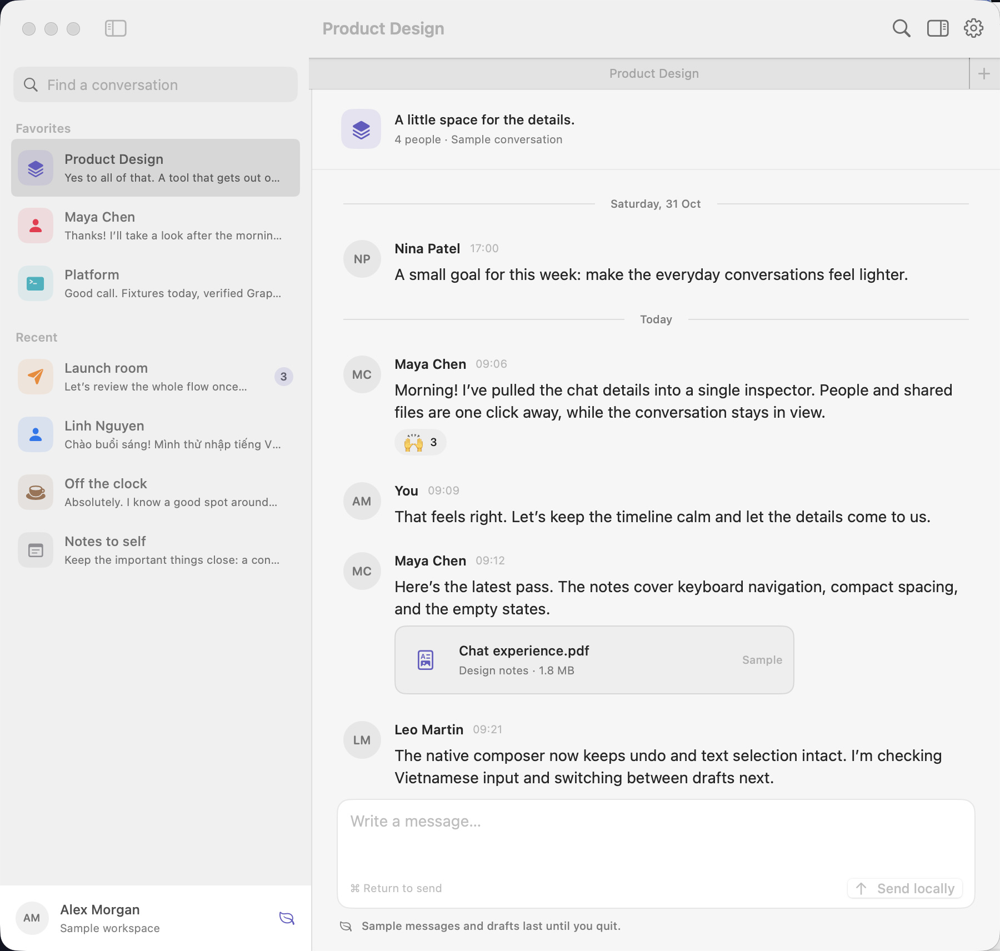

# OpenTeams

OpenTeams is an unofficial native macOS client for Microsoft Teams chats. It uses Teams web services and is not affiliated with Microsoft. Those private services can change without notice, and functionality may stop working.



*Mock-data preview of the Sample Workspace, captured with CleanShot.*

## Requirements and setup

- macOS 14 or later
- Swift 6 and Xcode or the Xcode Command Line Tools
- A Microsoft Teams work or school account

From the repository root, set up a local signing identity and pin the credential helper once on a new installation:

```sh
python3 script/setup_local_signing.py
./script/pin_credential_helper.sh
./script/build_and_run.sh
```

The build script creates and signs `dist/OpenTeams.app` and opens it. The local identity is stored in the login Keychain; this build is not notarized. If you already have the earlier TeamsChat installation and its pinned helper, keep the existing identity and helper and run the build script directly. Do not regenerate the helper over an existing version: changing its identity requires a credential migration.

To check the build and run the test suite:

```sh
./script/build_and_run.sh --verify
./script/test.sh
```

The build script also supports `--build-only`, `--debug`, `--logs`, and `--telemetry`. `TEAMSCHAT_SIGNING_IDENTITY` can select the identity used to pin the helper. The script verifies the helper before replacing the staged app and stops both OpenTeams and the older TeamsChat process before launch.

## Features and limitations

OpenTeams provides a conversation list, paginated history, message rendering, search, participant details, local drafts, text and emoji sending, replies, reactions, and supported message editing. It can display Teams-hosted images and provides previews for supported images and PDFs. Cached chats can remain readable when disconnected; cache and drafts are separated by account.

Some features have only local fixture coverage. In particular, live rich sending and editing, custom group pictures, and SharePoint image and PDF content previews have not been fully verified. Uploads, Office previews, original-file downloads, and closed-app push notifications are not implemented. Fresh-account and MFA sign-in, tenant policies, guest and consumer accounts, and long-running unattended session recovery have not been fully verified. Organization policies or changes to Microsoft sign-in may prevent a connection. Delivery may be uncertain after a network failure; the app does not automatically retry an ambiguous send.

Choose **Connect to Teams** and sign in with your own work or school account through the Microsoft Teams WebKit window. The app discovers the account, tenant, and service routes from that session; it does not require a pre-existing browser capture or a development session pipe. The app stores session credentials in macOS Keychain and uses a persistent WebKit sign-in store. Downloaded chat data is stored locally in the user's Application Support directory with restricted file permissions; the application does not encrypt that cache. Settings also offers a fictional Sample Workspace.

Shortcuts include **⌘L** to focus the composer, **⌘ Return** to send, **⌘F** to search downloaded messages, **⌥⌘I** for details, **⌘R** to refresh, and **⌘,** for Settings.

## Upgrade compatibility

The app retains its legacy `dev.native.teamschat` bundle identifier, credential helper identity, Keychain service, and `~/Library/Application Support/TeamsChat` storage paths so that an existing installation can retain its sign-in and local data. Internal Swift module names also retain their legacy names.
