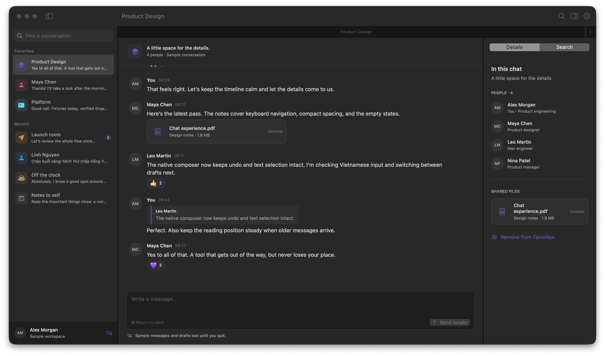

# OpenTeams

A native macOS client for Microsoft Teams chats, written in Swift 6 with SwiftUI. No Electron, no browser-tab wrapper — a real macOS app that talks to the same Teams web services the web client uses.

<p>
  
  
  
  
</p>

> **Unofficial project.** OpenTeams is not affiliated with, endorsed by, or supported by Microsoft. It relies on private Teams web services that can change without notice, and functionality may stop working at any time. Use it with your own account, at your own risk.

| Light | Dark |
| :---: | :---: |
|  |  |
| *Sample Workspace, light* | *Sample Workspace, dark* |

Both screenshots show the built-in **Sample Workspace**: entirely fictional mock data, no real account, tenant, or conversation.

---

## Contents

- [Why this exists](#why-this-exists)
- [Features](#features)
- [Not implemented or not yet verified](#not-implemented-or-not-yet-verified)
- [Requirements](#requirements)
- [Getting started](#getting-started)
- [Installing into /Applications](#installing-into-applications)
- [Usage](#usage)
- [Building and testing](#building-and-testing)
- [Architecture](#architecture)
- [Security and privacy](#security-and-privacy)
- [Troubleshooting](#troubleshooting)
- [Contributing](#contributing)
- [License](#license)

## Why this exists

Teams in a browser tab is memory-hungry, loses its place when you close the window, and competes with the rest of the desktop for focus. OpenTeams is a small, focused native client for the part of Teams most people live in: reading and answering chat.

It signs in through a real Microsoft sign-in window, discovers your account, tenant, and service routes from that session, and then renders conversations with native views, native scrolling, native search fields, and native keyboard shortcuts.

## Features

**Conversations and history**

- Account-scoped conversation list with unread state, participant avatars, and favorite/custom folders
- Paginated message history with a stable scroll anchor across paging and refresh
- Message rendering for formatted text, quotes, mentions, reactions, system messages, and deleted placeholders
- Search across downloaded messages
- Participant and conversation details inspector
- Account switching with isolated caches, drafts, and read state

**Composing**

- Rich composer with bold, italics, lists, quotes, links, code, emoji, and `@` mention picking
- Local drafts that survive conversation switches, app restarts, and crashes
- Replies, reactions, and editing of supported messages
- `⌘ Return` to send, with pending-send state persisted before the request leaves the app

**Media**

- Teams-hosted inline images
- Previews for supported images and PDFs

**Offline and recovery**

- Cached conversations stay readable when disconnected
- Read state, drafts, and cache separated per account
- Refresh policy that retries transient failures without duplicate or ambiguous reads

A **Sample Workspace** with fictional conversations ships with the app, so the UI can be explored without signing in to anything.

## Not implemented or not yet verified

Being honest about coverage is more useful than a longer feature list.

- **Not implemented:** file uploads, Office document previews, original-file downloads, closed-app push notifications
- **Locally verified only:** live rich sending and editing, custom group pictures, SharePoint-hosted image and PDF previews
- **Not fully verified:** fresh-account and MFA sign-in, tenant policies, guest and consumer accounts, long-running unattended session recovery
- **Known gap:** after a network failure the outcome of a send can be unclear; the app does not automatically retry an ambiguous send

Organization policies or changes to Microsoft sign-in can block the connection entirely. That is outside this project's control.

## Requirements

- macOS 14 (Sonoma) or later
- Swift 6 toolchain — Xcode 16 or the Xcode Command Line Tools
- A Microsoft Teams work or school account (live use only; the Sample Workspace needs no account)

## Getting started

```sh
git clone git@github.com:hxutixnnn/openteams.git
cd openteams
```

Set up a local signing identity and pin the credential helper. Both are **one-time** steps per installation:

```sh
python3 script/setup_local_signing.py
./script/pin_credential_helper.sh
```

Then build, sign, and launch:

```sh
./script/build_and_run.sh
```

The build script produces and signs `dist/OpenTeams.app`, then opens it. The signing identity is a local self-signed certificate in your login Keychain; this build is **not notarized**, which is expected for a local development build.

Other build modes:

```sh
./script/build_and_run.sh --build-only   # build and sign, do not launch
./script/build_and_run.sh --debug        # launch under lldb
./script/build_and_run.sh --logs         # launch and stream process logs
./script/build_and_run.sh --telemetry    # launch and stream this app's os_log subsystem
./script/build_and_run.sh --verify       # launch and verify staged app processes
```

`TEAMSCHAT_SIGNING_IDENTITY` selects the identity used to pin the helper.

> **Never regenerate the credential helper over an existing installation.** Changing its identity requires a credential migration. If you already have a working install, keep the existing identity and helper and run `./script/build_and_run.sh` directly.

## Installing into /Applications

```sh
./script/build_and_run.sh --build-only
./script/install.sh
```

The installer verifies the app's signature and the pinned credential helper before copying. When replacing a matching installation it keeps the previous app in a hidden staging directory under `/Applications`, and it refuses to replace an unrelated app. It does not touch your sign-in or local data.

The app keeps the legacy `dev.native.teamschat` bundle identifier, credential helper identity, Keychain service, and `~/Library/Application Support/TeamsChat` storage paths so an existing installation retains its sign-in and local data. Internal Swift module names keep their legacy names too.

The icon source is `assets/icon/OpenTeams-source.png`; run `./script/build_icon.sh` after changing it to regenerate the bundled `.icns`.

## Usage

1. Launch the app and choose **Connect to Teams**.
2. Sign in with your own work or school account in the Microsoft Teams sign-in window.
3. The app discovers your account, tenant, and service routes from that session — no browser capture, no developer session pipe.

To try the UI without an account, open **Settings** and switch to the **Sample Workspace**.

| Shortcut | Action |
| --- | --- |
| `⌘ L` | Focus the composer |
| `⌘ Return` | Send message |
| `⌘ F` | Search downloaded messages |
| `⌥ ⌘ I` | Toggle details inspector |
| `⌘ R` | Refresh conversations |
| `⌘ ,` | Settings |

## Building and testing

Build a single product without launching anything:

```sh
swift build --jobs 4 --product OpenTeams
```

Run the Swift test suite (core plus app):

```sh
./script/test.sh
```

Run the isolated end-to-end workflows:

```sh
python3 script/test_performance_e2e.py --skip-build
python3 script/test_fixture_deletion_e2e.py --skip-build
./script/test_credential_prototype.sh
./script/test_credential_service.sh
./script/test_pinned_helper.sh
```

The E2E workflows build fictional chat histories, account-scoped temporary storage, cross-process draft recovery, and intercepted send requests. They never launch the main GUI bundle against real account data, and they measure completed store operations — not native frame rates or input-to-display latency. See [Tests/E2E/PERFORMANCE.md](Tests/E2E/PERFORMANCE.md) for paired measurements and [Tests/E2E/APP.md](Tests/E2E/APP.md) for the native app journeys.

To prepare an isolated debug fixture bundle for manual UI testing:

```sh
python3 script/prepare_app_e2e.py --cached-history-count 2000
```

## Architecture

`Package.swift` builds one app, one core library, and a small credential stack.

| Target | Kind | Role |
| --- | --- | --- |
| `TeamsChat` | executable | SwiftUI app shell: window, sidebar, detail, inspector, composer, settings, notification routing, refresh coordination |
| `TeamsCore` | library | Models, fixture store, Teams web clients, reader store, read cache, rich drafts, presentation, refresh policy |
| `TeamsCredentialIPC` | library | XPC protocol shared by app and credential helper |
| `TeamsCredentialBridge` | library | Client side of the credential helper connection |
| `TeamsCredentialPersistence` | library | Keychain-backed session credential storage |
| `TeamsCredentialService` | executable | Pinned XPC credential helper bundled into the app |
| `TeamsCredentialPrototype`, `TeamsCredentialBridgeProof` | executables | Standalone tools that exercise and verify the credential path |

Source layout:

```
Sources/TeamsChat/         App/ · Services/ · Support/ · Views/
Sources/TeamsCore/         Models/ · Services/ · Fixtures/
Sources/TeamsCredential*/  IPC · bridge · persistence · helper
Tests/TeamsCoreTests/      store, cache, and presentation tests
Tests/TeamsChatTests/      reader, reaction, timeline, and deletion tests
Tests/E2E/                 app-core E2E workflows and performance evidence
script/                    build, sign, install, and E2E runners
assets/                    icon sources and screenshots
```

Only external dependency: [SwiftSoup](https://github.com/scinfu/SwiftSoup) `2.9.6` (pinned exactly), used for parsing Teams message HTML.

## Security and privacy

- **Credentials** live in the macOS Keychain. The app does not read them directly; a bundled XPC credential helper owns that boundary.
- **Helper pinning** — the build and install scripts verify the helper's signing identity before staging or replacing the app, so a swapped helper is rejected.
- **Local data** — downloaded chats, drafts, and read state live under `~/Library/Application Support/TeamsChat/` with restricted file permissions. **This cache is not encrypted.**
- **Network** — traffic goes only to Microsoft Teams services. There is no analytics, crash reporting, or third-party endpoint. The `--telemetry` build mode streams the app's own `os_log` subsystem to your terminal, locally.

Found a security issue? Please report it privately through GitHub's security advisory feature rather than opening a public issue.

## Troubleshooting

| Symptom | Fix |
| --- | --- |
| `A stable signing identity is required` | Run `python3 script/setup_local_signing.py`, then retry the build. |
| `The pinned credential helper is missing or invalid` | Do not regenerate it blindly. Re-run `./script/pin_credential_helper.sh` only on a fresh installation; otherwise migrate credentials deliberately. |
| Sign-in window closes or the connection is refused | Your organization may block third-party clients. Verify the same account works in a browser on this machine. |
| Messages fail after a network drop | Reconnect and refresh with `⌘ R`. The app does not retry an ambiguous send automatically. |
| `swift test` cannot load testing macros | Use `./script/test.sh`, which resolves the plugin path for the Command Line Tools. |

## Contributing

Contributions are welcome — issues, bug reports, and pull requests.

- Open an issue before large changes so scope can be agreed first.
- Keep changes small and focused; avoid unrelated cleanup and speculative abstractions.
- Match the surrounding style. This codebase favors self-explanatory naming and simple structure over explanatory comments.
- Prefer end-to-end coverage over new unit tests, and never include real account data, tokens, or tenant identifiers in tests, fixtures, or screenshots.
- Commit messages follow conventional prefixes, for example `fix(chat): mark visible conversations as read`.

## License

[MIT](LICENSE) © 2026 Nghia Nguyen

Microsoft, Microsoft Teams, and related marks are trademarks of Microsoft Corporation. This project is an independent, unofficial client and is not affiliated with or endorsed by Microsoft.
